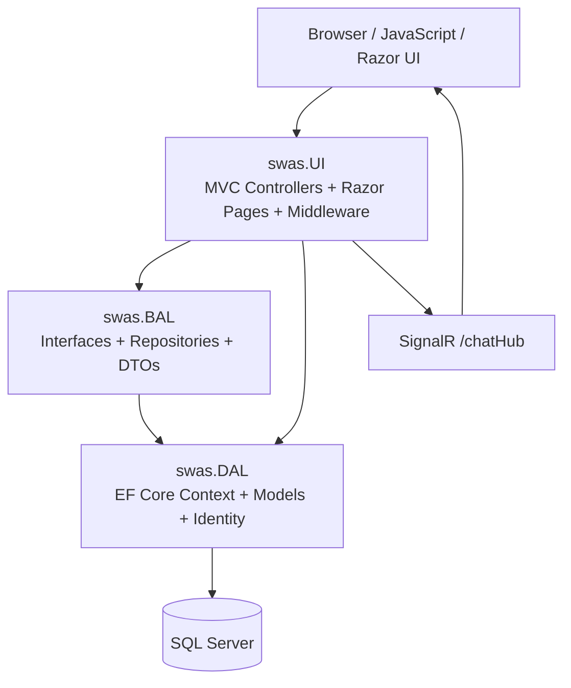

# 2. System Architecture

## Architecture style

The solution is a layered ASP.NET Core application. The UI project is the composition root and directly references both BAL and DAL. BAL references DAL. Repositories are registered through dependency injection and usually expose interfaces to controllers.

## Runtime pipeline

`Program.cs` configures the DbContext, repositories, Identity, MVC, Razor Pages, authorization, session, CORS, SignalR, response compression, and logging. The request pipeline then applies exception handling, static files, HTTPS redirection, security headers, cookie policy, routing, CORS, session, authentication, session validation, authorization, controller routes, Razor Pages, and SignalR.

## Data access patterns

- EF Core LINQ and `DbSet<T>` are used for normal entity access.
- `FromSqlRaw` and `Database.SqlQuery<T>` are used for selected stored-procedure/report results.
- ADO.NET `SqlCommand` is used for procedures returning multiple result sets or output values.
- Dapper is used in selected project and stakeholder repositories.

## Architectural observations

Controllers sometimes inject both repositories and `ApplicationDbContext`; therefore the repository boundary is not absolute. No separate API project or `ApiController` convention was found. JSON endpoints are MVC actions inside the UI project.
