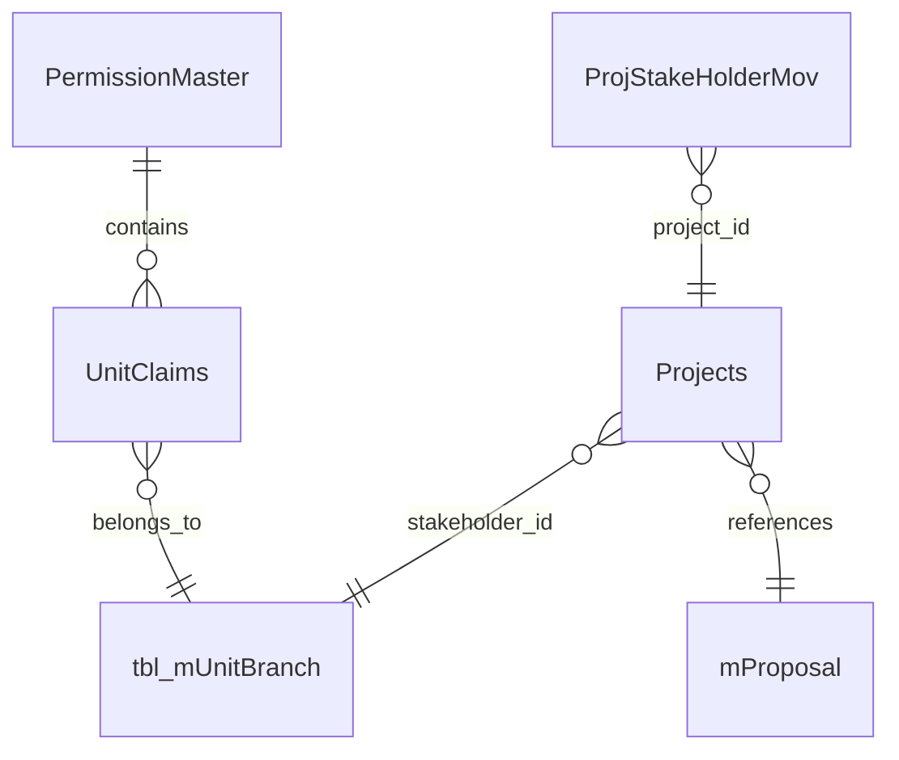

# 5. Database Documentation

## Database access

`ApplicationDbContext` inherits from `IdentityDbContext<ApplicationUser>` and is configured for SQL Server. It exposes Identity sets plus application entities including projects, stages, actions, statuses, units, stakeholders, movements, comments, attachments/history, chat, notifications, reminders, certificates, audit, permissions, and reporting types.

## Verified relationship mappings

The explicit EF relationship in the current context is:

The last three links are inferred from model foreign-key attributes and property names; database-enforced constraints for all of them were not independently verified. `UnitClaims.PermissionId` to `PermissionMaster` is explicitly configured with restricted delete behavior.

## Main entity groups

| Group | Representative tables/models |
|---|---|
| Identity | `AspNetUsers`, `AspNetRoles`, user/role/claim/login/token tables |
| Project workflow | `Projects`, `ProjStakeHolderMov`, `ProjStakeHolderCcMov`, `mStages`, `mStatus`, `mActions`, mappings |
| Organization/master data | `tbl_mUnitBranch`, `mCorps`, `mRank`, `mAppType`, `mHostType`, `mCommand`, `mProposal` |
| Collaboration | `Comment`, `StkComment`, `StkStatus`, chat mapping/messages, notifications |
| Governance/history | `AttHistory`, `LegacyHistory`, `AuditLog`, `tbl_LoginLog`, reminders |
| Permission | `PermissionMaster`, `UnitClaims`, role/user/unit permission tables used by repositories |
| Certificate/document | certificate master/content, document type, whitelist and attachment-related types |

## Stored procedures and queries

Application code calls procedures including `usp_GetProjectWiseStatus`, `usp_GetDashboardApproved`, `usp_GetActDraftItems`, `usp_GetActInbox`, `GetMyProjects`, `GetLatestWhiteListedProjects`, `GetForeCloseitems`, `GetMaxPsmId`, `usp_DashboardCount`, `usp_DashboardChartSummary`, `GetProjectHistoryByID_Dapper`, `GetActProjects_Dapper`, `GetProcProj_Dapper`, `ProjectHolsTimeCalculate_Dapper`, `CheckPreviousApprovals_Dapper`, and `USP_GetAuditLogHistory`.

The checked-in SQL script defines or references only a subset, including `getAppTypeCounts`, `getMonthInOutSummary`, `getMonthInOutSummarySINGLE`, `GetMonthInOutSanJson_FIN`, and `NewSpSanalOne`. Procedure bodies for many current application calls are not present, so parameters, indexes, exact joins, and result contracts must be obtained from the deployed database.

## Migration status

One EF Core migration named `20230731110252_initial` and a model snapshot are present. The migration creates Identity and core application tables, but the repository also contains newer models and SQL artifacts. Do not assume the migration alone represents the current production schema.
