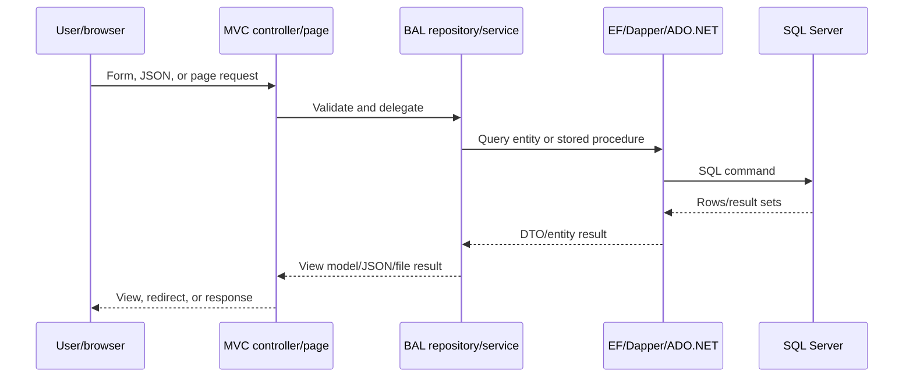

# 7. Business Logic and Data Flows

## Project creation flow

The project form is rendered by MVC views and populated with dropdown/master data. The controller reads the authenticated application session, validates model fields, delegates persistence to project and related repositories, stores uploaded files under application content paths, and redirects or returns validation/JSON results. Project fields include dates, sponsor/unit, software classification, AI/ML flag, whitelisting state, contact data, and workflow flags.

## Movement and approval flow

Project movement is represented by `ProjStakeHolderMov` with project ID, source/target unit, status-action mapping, timestamp, remarks, completion/read/parked/foreclosed flags, and optional CC/attachments. Repository procedures calculate dashboard and history results. The exact transition matrix is database-backed and cannot be fully verified without deployed procedure definitions.

## Dashboard flow

`HomeController` uses project, chart, action, history, unit, and date-approval services. `ChartService` executes stored procedures for month in/out and application-type counts. Results are mapped to chart DTOs/models for Razor/JavaScript rendering.

## Permission flow

1. An authenticated Identity user has a `unitid`.
2. `UnitClaimsTransformation` loads active permission keys for that unit from `UnitClaims`/`PermissionMaster`.
3. Keys are cached for up to five minutes with a two-minute sliding expiration.
4. `AuthorizePermission("X")` creates policy `Permission:X`.
5. `PermissionAuthorizationHandler` succeeds when the principal contains a matching `Permission` claim.

## Chat flow

MVC chat actions persist mappings/messages through repositories. The SignalR hub sends live notifications using `ReceiveMessage`; chat history is loaded separately through controller JSON actions.

## Audit flow

The audit repository calls `USP_GetAuditLogHistory`, converts UTC timestamps to India Standard Time, and turns change flags into field-level change items such as stage, sub-stage, action, forwarding unit, remarks, and timestamp.

## Data-flow diagram

