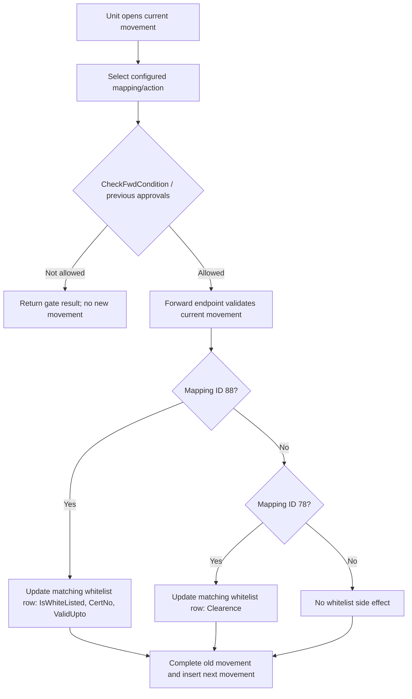

# Approval and Rejection Workflow

## UC-09

**Purpose:** Expose decision actions through the configured status/action mapping and prevent forwarding when required prior approvals are not present.

**Actors:** Receiving unit/approver; project stakeholder; Dte/central unit where configured; administrator maintaining mappings.

## What is verified

The application does not contain one fixed approval/rejection enum or a complete transition table. A decision is represented by a `ProjStakeHolderMov.StatusActionsMappingId`, which resolves to a status and action through `TrnStatusActionsMapping`. Human-readable names and allowed next mappings are data-driven.

`CheckFwdCondition` is called with project ID, status ID, and action name. For non-`Info` actions and non-initial status, it looks for an active, non-undone movement for the same project/status where the mapped action is ID `2`. For status ID `1`, it looks for a mapped action ID `1` movement addressed to unit `1`, marked as a comment, active, and not undone. This returns a Boolean gate.

`CheckPreviousApprovals` decrypts project/status/action values and calls repository `CheckPreviousApprovals(statusId, projid, actionsId)`. Its detailed query is not visible in the checked-in SQL, so the exact approval prerequisites are not stated here.

## Decision flow

## Approval, rejection, observation and closure distinction

- **Approval/rejection meaning:** not independently verifiable without status/action seed data or deployed procedures. The code only proves mapping-driven movement persistence and specific branches for IDs 78 and 88.
- **Observation/comment:** represented by `IsComment`, `Comment`/`StkComment` data and comment/process movement paths.
- **Closure:** represented separately by movement `ForeClosed` and `tbl_project_foreclose`.
- **Whitelist:** represented by `trnWhiteListed` and certificate service/controller paths.

## Database effects

| Effect | Table/entity |
|---|---|
| Decision/routing history | `ProjStakeHolderMov` |
| Resolve action/status/stage | `TrnStatusActionsMapping`, `mStatus`, `mActions`, `mStages` |
| Approval prerequisite/date approval | `DateApproval`, `LegacyHistory` where the corresponding branch is used |
| Whitelist side effect | `trnWhiteListed` for mapping IDs 78 and 88 |
| Audit of edited movement | `AuditLog` via `ProjectMovementUpdate` |

## Missing information to obtain from deployment

1. Complete rows and descriptions in `mStatus`, `mActions`, `TrnStatusActionsMapping`, and `TrnUnitStatusMapping`.
2. Procedure body/parameters for `CheckPreviousApprovals_Dapper` or the repository implementation if deployed separately.
3. Business meaning of mapping IDs `1`, `21`, `26`, `31`, `37`, `78`, `88`, `144`, `149`, `154`, and `159`.
4. Which actor/role is allowed to perform each configured action.
