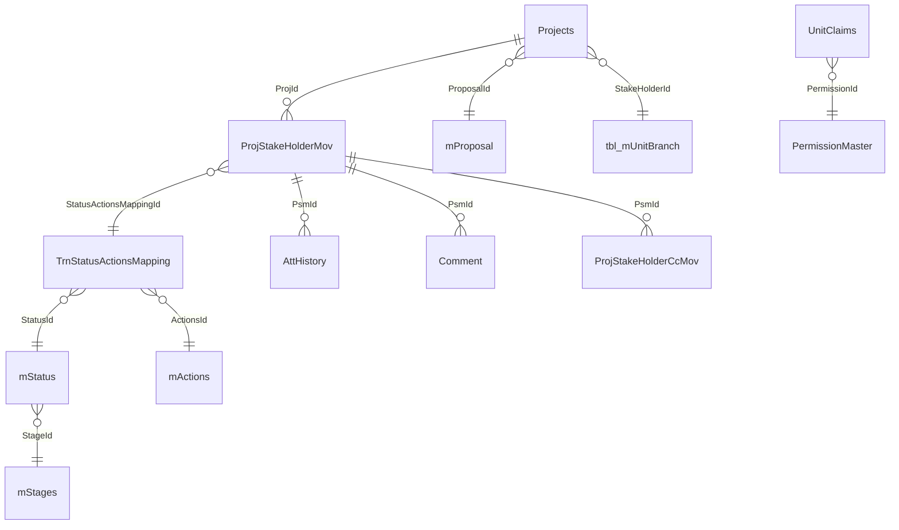

# Database Workflow

## Access mechanisms

`ApplicationDbContext` inherits from `IdentityDbContext<ApplicationUser>` and is configured for SQL Server. Repositories use three access styles:

1. EF Core LINQ and `SaveChangesAsync` for entities and transactional writes.
2. Dapper for procedure reads such as project lists/history.
3. ADO.NET `SqlConnection`/`SqlCommand` for procedure reads and integrations.

## Main tables/entities

| Area | Tables/models | Operations evidenced |
|---|---|---|
| Identity | `AspNetUsers`, roles, claims, logins, tokens | Identity login/registration/management. |
| Project | `Projects`, `mProposal`, unit/master tables | Insert/update/select project data. |
| Movement | `ProjStakeHolderMov`, `ProjStakeHolderCcMov` | Insert, update completion/read/pullback/parking/foreclosure, select history/inbox. |
| Mapping | `mStages`, `mStatus`, `mActions`, `TrnStatusActionsMapping`, `TrnUnitStatusMapping` | Select/maintain workflow configuration. |
| Evidence | `AttHistory`, `DocumentTypes` | Required-document select; attachment insert/select/history. |
| Comments | `Comment`, `StkComment`, `StkStatus` | Insert/select stakeholder/project comments/status. |
| Closure | `tbl_project_foreclose` via `ProjectForeclose` | Transactional insert/update on close/reopen. |
| Approval/history | `DateApproval`, `LegacyHistory`, `AuditLog` | Date request insert/update; legacy and movement edit audit writes. |
| Collaboration | `Notification`, `trnRemainder`, `mUserMapChat`, `TrnChatMsg` | Notification/reminder/chat persistence. |
| Whitelist/certificate | `trnWhiteListed`, certificate master/content | Whitelist updates and certificate reads/generation. |

## Core relationships

Some relationships are model annotations or repository joins rather than verified database constraints. `UnitClaims.PermissionId` is explicitly configured with restricted delete behavior.

## End-to-end write traces

### Create/submit

`AddProject` -> `ProjectsRepository.AddProjectAsync`/`UpdateProjectAsync` -> EF `Projects` save -> initial/current `ProjStakeHolderMov` changes and optional `DateApproval`/`LegacyHistory` changes. Submission then selects `DocumentTypes` and `AttHistory`; it updates `Projects.IsSubmited`.

### Forward

`FwdToProject` -> current `ProjStakeHolderMov` select -> current row update (`IsComplete`) -> new `ProjStakeHolderMov` insert -> `AttHistory` file metadata insert and physical `wwwroot/Uploads` write -> optional `ProjStakeHolderCcMov` inserts. Whitelist mapping 78/88 updates `trnWhiteListed` before movement persistence.

### Close/reopen

Repository method begins EF transaction -> selects latest active movement -> updates `ForeClosed` -> inserts/updates `ProjectForeclose` -> save/commit; exceptions rollback.

### Movement edit/audit

`ProjectMovementUpdate` -> movement update -> compares original/new mapping, remarks, timestamp, target -> inserts `AuditLog` with serialized old/new JSON.

## Stored procedure inventory

| Procedure reference | Call site/parameters visible | Definition in checked-in SQL? |
|---|---|---|
| `usp_GetProjectWiseStatus` | `@Projid` | Not found |
| `usp_GetDashboardApproved` | `@StatusId`, `@StatusActionsMappingId`, `@projecttype` | Not found |
| `usp_GetActCompleteItems` | `@UnitId` | Not found |
| `usp_GetActDraftItems` | `@UnitId` (see repository) | Not found |
| `usp_GetActInbox` | `@UnitId` (see repository) | Not found |
| `usp_GetActSendItems` | parameters in repository | Not found |
| `usp_GetActCcItems` | parameters in repository | Not found |
| `GetMyProjects` / `GetMyProjects_Dapper` | `@StakeHolderId` | Not found |
| `GetProjectHistoryByID_Dapper` | `@ProjId` | Not found |
| `GetActProjects_Dapper` | `@Role`, `@StakeHolderId` | Not found |
| `GetProcProj_Dapper` | parameters in repository | Not found |
| `GetLatestWhiteListedProjects` | `@TypeId` | Not found |
| `InsertWhiteListedProjects` | no visible parameter | Not found |
| `GetParkedProjects` | `@UnitId` | Not found |
| `GetForeCloseitems` | `@StakeHolderId`, `@CloseType` | Not found |
| `usp_GetProjLogView` | `@StartDate`, `@EndDate` | Not found |
| `getMonthInOutSummary` | no visible parameter | Defined in SQL |
| `getAppTypeCounts` | no visible parameter | Defined in SQL |
| `GetMonthInOutSanJson_FIN` | calls `getMonthInOutSummarySINGLE` | Defined/referenced in SQL |
| `usp_DashboardCount`, `usp_DashboardChartSummary` | parameters in repository | Not found |
| `USP_GetAuditLogHistory` | repository call | Not found |

The SQL file also contains legacy/core table definitions and seed data, but it does not represent every current EF model. Procedure parameters/result columns not visible in source are intentionally not invented.
