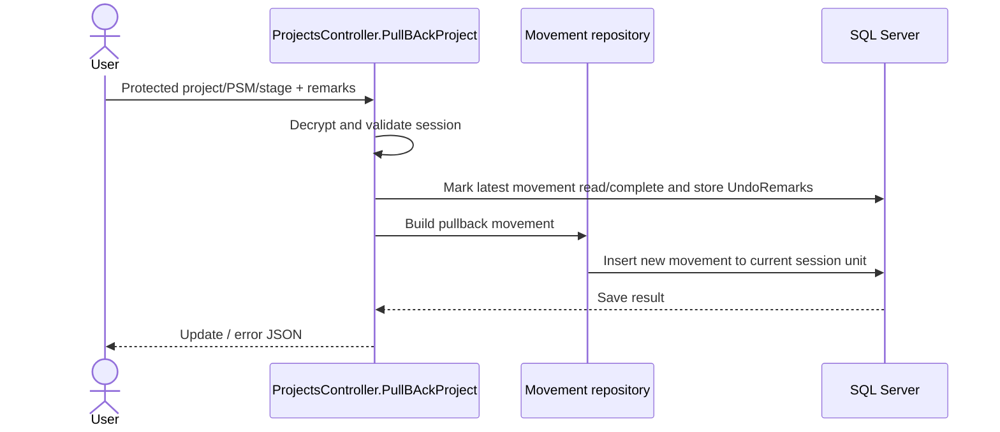

# Observation and Resubmission

## UC-05 / UC-07

**Purpose:** Record comments/observations and return a project movement for correction or further processing.

**Actors:** Receiving unit, stakeholder unit, central processor, and any unit addressed by the movement.

## Verified implementation model

The project movement model includes `IsComment`, `Remarks`, `UndoRemarks`, `IsPullBack`, `IsComplete`, `IsRead`, `FromUnitId`, `ToUnitId`, and `StatusActionsMappingId`. Comments can be stored in `Comment` against a PSM ID; stakeholder-specific comments/status use `StkComment` and `StkStatus` repositories. The configured mapping determines how the UI labels the action.

## Pullback flow

`PullBAckProject` marks the latest movement complete, sets `IsRead = true`, stores the supplied remarks as `UndoRemarks`, discovers the responsible unit/user details, then creates a new movement with a new PSM ID, target equal to the logged-in unit, `IsComplete = false`, `IsRead = false`, `IsPullBack = true`, and a formatted remark.

## Undo flow

`UndoProject(ProjectId, PsmId, Remarks, StageId)` refuses stage ID `1`. It marks the selected movement read, complete, pullback, and stores undo remarks. It then finds the previous movement for the project/unit, clears its remarks, and reopens it by setting `IsComplete = false` and `IsRead = false`.

## Comment/process flow

`ProcessMail` creates a sequence of comment movements using hard-coded mapping/target arrays. The sequence can skip the stakeholder comment row for configured units. `ProcessNotification` creates notification-oriented movement rows for units `[4,3,5,1]` and, when the stakeholder is not unit 1, the stakeholder unit as well; the exact remaining body and database behavior should be checked with the source/deployed procedure if needed.

## Resubmission interpretation

The source supports correction-and-return behavior through pullback/undo plus a subsequent normal forward. It does not expose a single method named “Resubmit” or a fixed observation status. Therefore this document calls it **observation/resubmission** only where the verified movement/comment pattern supports that interpretation; status descriptions must not be inferred.

## Alternatives and exceptions

- Invalid protected request or missing session: bad request/unauthorized.
- No prior movement: no-save result.
- Stage ID `1` in undo: operation is refused.
- Unread reminders for a project are marked read during pullback processing.
- Comment and stakeholder repositories expose CRUD/list paths; exact UI-required fields are governed by their model validation and view forms.
