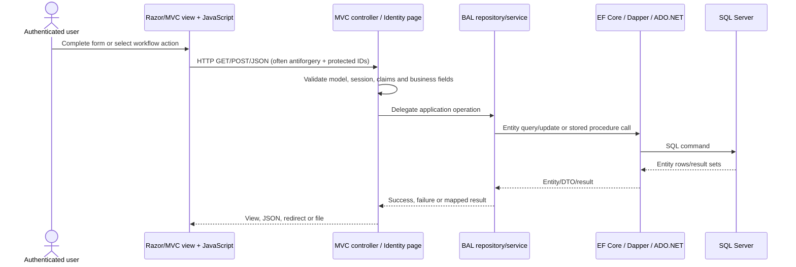
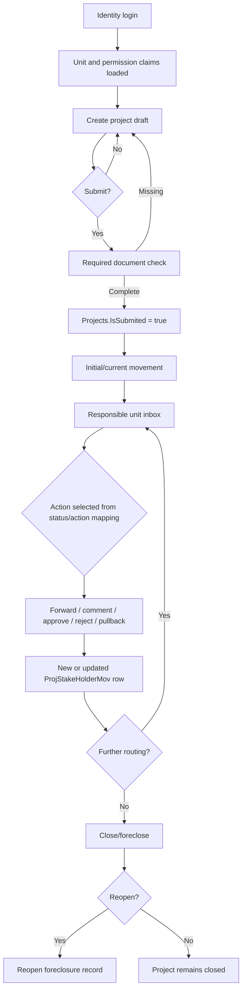

# PAW Overall Workflow

## Purpose

PAW is an authenticated ASP.NET Core application for registering software/application projects, routing them between organizational units, recording actions and comments, storing evidence, and tracking closure/whitelist outcomes.

## Layered execution model

## Main workflow

## Major actors

| Actor | Evidence-backed responsibility |
|---|---|
| Authenticated Identity user | Signs in and receives an application session. |
| Unit/stakeholder user | Creates projects, receives movements, forwards, comments, uploads evidence, and may request date changes subject to permissions. |
| Dte / central unit | Special processing paths are restricted in code to unit IDs 1 or 2 for `ProcessMail`; exact organizational meaning is data-driven. |
| Receiving unit | Determined by `ProjStakeHolderMov.ToUnitId`; can read, process, forward, comment, or pull back according to available actions and authorization. |
| Application administrator | Maintains actions, stages, statuses, units, stakeholders, mappings, and permissions through administration controllers. |
| SQL Server | Stores workflow entities and supplies configured procedure results/mappings. |

## Verified boundaries

The source proves movement rows and their flags, but does not provide a complete business transition matrix. Status descriptions, action descriptions, and mapping IDs are database data. The local SQL script contains legacy/core schema and some reporting procedures, but not all procedures referenced by the current repositories.
