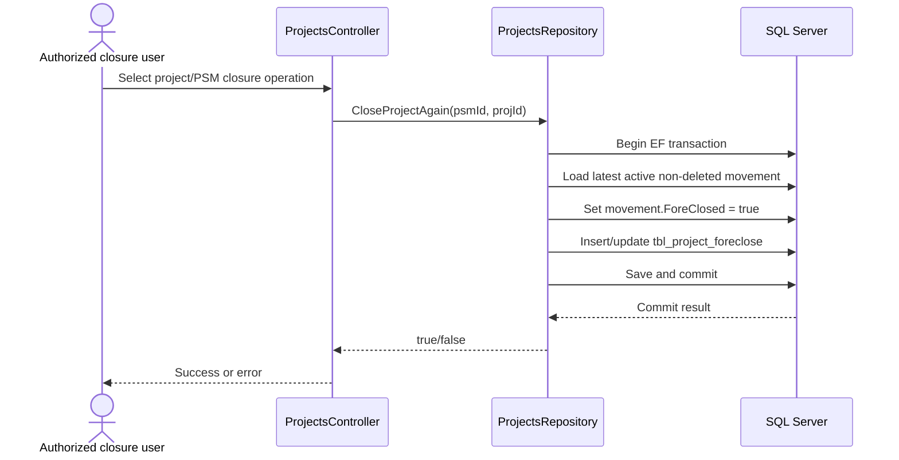
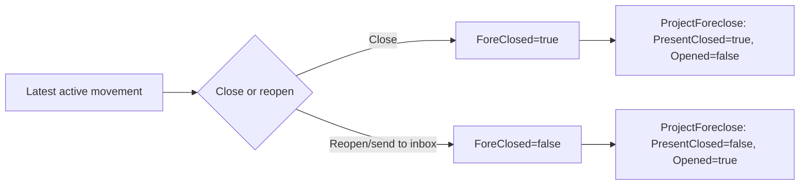

# Project Closure and Reopening

## UC-10

**Purpose:** Close a project/active movement and reopen it when the application presents a reopening action.

**Actors:** Authorized unit user or closure administrator; project stakeholder/receiving unit after reopening.

## Closure flow

`ProjectsController` exposes `GetForecloseitems`, `SendForecloseToInbox`, and `CloseProjectAgain`; `ProjectsRepository` implements the state-changing operations.

`CloseProjectAgain` loads the latest active/non-deleted movement by descending PSM ID. If none exists it returns false. It sets `ForeClosed = true`, then updates the latest `ProjectForeclose` row for the project or inserts one with `Psmid`, `Projid`, `IsPresentClosed = true`, `IsOpened = false`, and `ClosedDate`. Save and commit are inside an explicit EF transaction; errors roll back.

## Reopening flow

`SendForecloseToInbox` loads the latest active movement and sets `ForeClosed = false`. It then updates an existing foreclosure row or inserts one with `IsPresentClosed = false`, `IsOpened = true`, `OpenedDate = DateTime.Now`, and the requested PSM/project IDs. The operation also uses an explicit transaction and rolls back on error.

## Data fields

`ProjectForeclose` maps to `tbl_project_foreclose`: `ForecloseId`, `Psmid`, `Projid`, `ClosedByUserId`, `ClosedDate`, `IsPresentClosed`, `IsOpened`, and `OpenedDate`. The visible repository code does not populate `ClosedByUserId` in the shown close/reopen methods; this is a traceability gap, not an assumed behavior.

`GetForecloseitems(closetype)` reads a keyless DTO through stored procedure `GetForeCloseitems(@StakeHolderId, @CloseType)`. The procedure body is not in the checked-in SQL, so list eligibility and close-type meanings are not documented as facts.

## Exceptions

No current active movement returns false. Database errors roll back the transaction and propagate to the controller's error path. Authorization is partly controller/session/permission dependent and must be confirmed on the deployed UI route.
