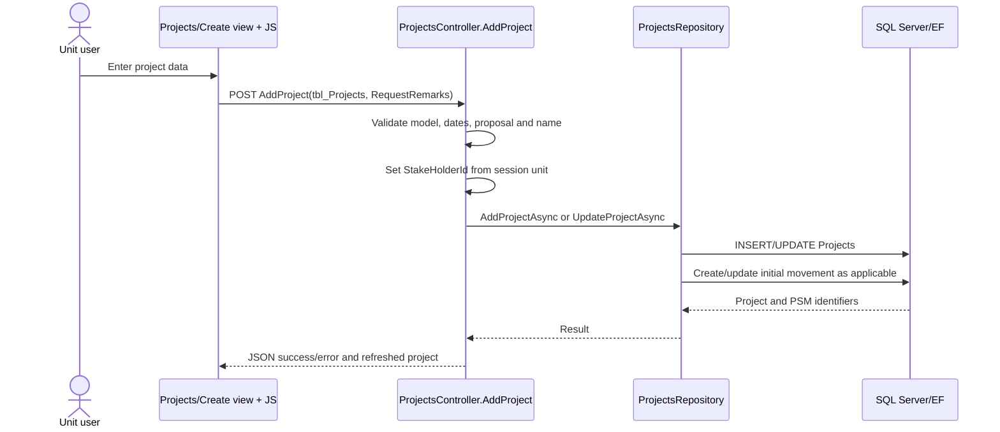

# Project Creation and Submission

## UC-02 / UC-03

**Purpose:** Create or edit a project draft, then submit it for workflow processing only when required evidence is present.

**Actors:** Authenticated unit/stakeholder user; receiving workflow unit after submission.

**Preconditions:** Identity authentication and `User` session; valid unit ID; project form and master data available.

**Trigger:** User submits the project form or selects submit/return.

## Main creation/edit flow

### Controller rules verified in `AddProject`

- New projects set `IsSubmited = false`; edits preserve the existing submission/process flags.
- Proposal IDs `5`, `7`, and `8` use a special form: many fields are ignored and set to `N/A`, AI/ML is false, host/application defaults are set to `1`, and dates default to `DateTime.Now`.
- Other projects set background/decision/title fields to `N/A` because those fields are not required in that branch.
- `StakeHolderId` is assigned from the logged-in session unit; audit/update user fields are system-populated.
- Completion date cannot precede initiation date and a changed completion date cannot be in the past for ordinary forms.
- New names are checked for duplicates. Re-vetted proposal ID `3` has special name generation/validation.
- Existing submitted-but-not-processing projects lock initiation/completion/date-update fields.
- Save delegates to `ProjectsRepository.AddProjectAsync` or `UpdateProjectAsync`.
- If `OldPsmid` is present, old attachment history is copied to the new movement in the re-vetting path.

## Submission flow

`ProjectsController.ProjectSubmited(projid, type, Remarks)` loads the project. For `type == 1`, it selects active required document types and compares them with distinct `AttHistory.DocumentTypeId` rows where `PsmId == project.CurrentPslmId`. Missing documents return type `404`; otherwise `IsSubmited` becomes true. A non-1 type returns the project to draft (`IsSubmited = false`). `UpdateProjectAsync` persists the project and may update date approval/history.

## Database effects

| Operation | Entity/table | Evidence |
|---|---|---|
| Create/update project | `Projects` | EF repository save. |
| Initial/current movement | `ProjStakeHolderMov` | `AddProjectAsync`/`UpdateProjectAsync`; mapping can be `1` or `159` in update branch. |
| Required evidence check | `DocumentTypes`, `AttHistory` | EF queries in `ProjectSubmited`. |
| Re-vetted evidence copy | `AttHistory` | Controller inserts copied records. |
| Date-change request | `DateApproval`, `LegacyHistory` | `UpdateProjectAsync` when dates are editable and submission/date-type conditions match. |

No stored procedure is called by `AddProject` or `ProjectSubmited` directly. The project repository uses procedures for several list/history/read operations; exact create/update procedure behavior is not used in the visible path.

## Alternatives and exceptions

- Invalid model: HTTP 400 with field errors.
- Missing session: unauthorized response.
- Duplicate name: JSON `-3`; missing re-vetted name: JSON `-5`.
- Invalid dates: JSON `-6`, `-7`, or `-8` depending on condition.
- Missing project during edit: not found.
- Required evidence missing: submission is blocked.
- Repository/database failure: logged and returned as error/exception response.
