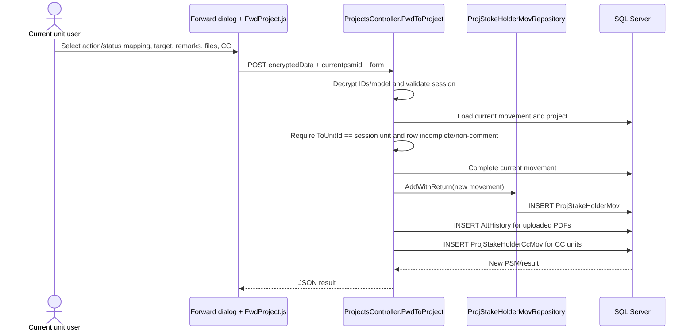

# Project Forwarding Workflow

## UC-04 / UC-06

**Purpose:** Move an active project movement from the responsible unit to another unit, optionally copying evidence and notifying CC units.

**Actors:** Current receiving unit; target unit; optional CC units; central processor for configured comment sequences.

## Forwarding sequence

## Main workflow

1. Client submits an encrypted project/movement payload. The current PSM ID is also protected.
2. Controller decrypts and validates project ID, mapping ID, target unit, date, and session unit.
3. Forward dates earlier than project initiation are rejected.
4. Optional files must be PDF, no larger than 10 MB, and pass the `%PDF` signature check.
5. If the mapping is `88`, an existing whitelist row with the same project name is marked whitelisted and receives certificate/validity timestamps. If mapping is `78`, its clearance timestamp is updated. These are explicit code branches; descriptions for 78/88 are not locally defined.
6. The current movement must exist and be addressed to the logged-in unit, incomplete, active, and non-comment.
7. The current row is marked complete.
8. A new active movement is created with source unit, target unit, mapping ID, timestamp, remarks, user details, and flags. If source and target are equal it is marked read; CC sets `IsCc`.
9. Optional PDF files are written under `wwwroot/Uploads` using generated names and inserted into `AttHistory` with the new PSM ID.
10. Optional CC IDs create `ProjStakeHolderCcMov` rows.
11. Reminders are marked read for the sending unit and comment movements are reset to unread in the implemented branch.

## Other movement operations

- `FwdProjConfirm(PslmId)` marks a movement complete and returns JSON `4`.
- `IsReadInbox(PsmId)` finds the movement for the session unit and sets `IsRead = true`; it also checks CC movement where applicable.
- `ProjectMovement`/`ProjectMovHistory` join project, movement, unit, status, stage, and action data for history screens.
- `ProjectMovementUpdate` updates an existing movement and writes an `AuditLog` row containing old/new JSON for changed mapping, remarks, timestamp, or target unit.

## Process/comment routing

`ProcessMail` is restricted to sessions with unit ID 1 or 2. It creates movement rows using the hard-coded arrays:

| Sequence | Mapping ID | Target unit |
|---:|---:|---:|
| 1 | 26 | 4 |
| 2 | 31 | 3 |
| 3 | 37 | 5 |
| 4 | 21 | 1 |
| 5 | 21 | project stakeholder unit (skipped for configured units) |
| 6 | 144 | 2 |
| 7 | 149 | 2255 |
| 8 | 154 | 2256 |

This is verified routing code, but the business descriptions of these IDs must come from deployed mapping data.

## Exceptions

Invalid encrypted data, missing session, invalid IDs, unknown current PSM, unauthorized current unit, target unit zero, target equal to CC unit, invalid PDF, oversized PDF, invalid file signature, missing project, or repository failure return documented JSON/error responses and prevent normal forwarding. No single transaction wraps all movement, attachment, and CC writes in `FwdToProject`; partial persistence should therefore be considered a recoverability risk.
