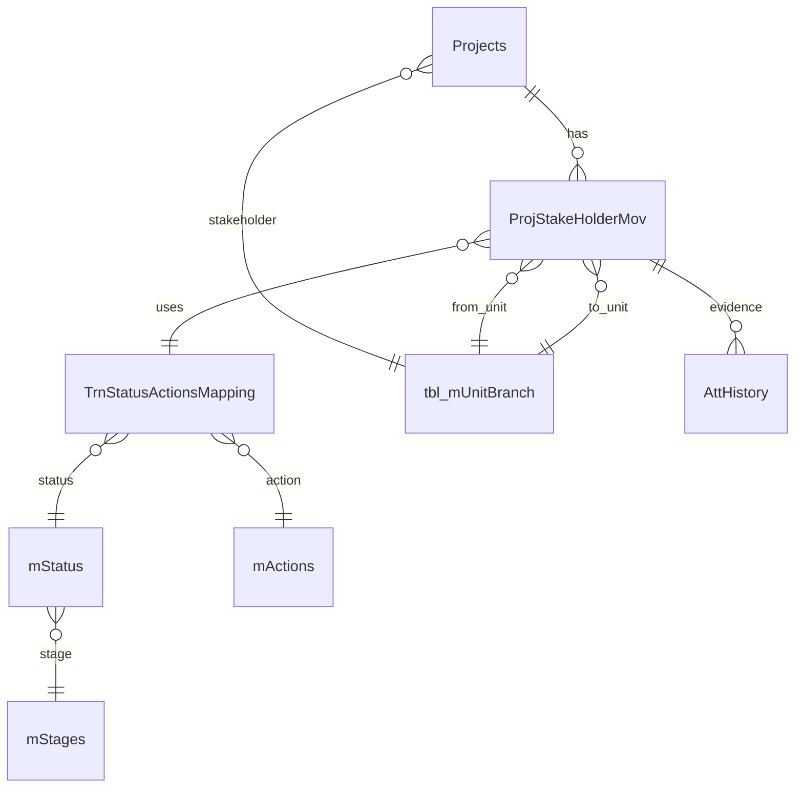

# Project Lifecycle

## Lifecycle data model

A project is stored in `Projects` (`tbl_Projects`) and its routed history in `ProjStakeHolderMov` (`tbl_ProjStakeHolderMov`). The project stores lifecycle flags such as `IsActive`, `IsDeleted`, `IsSubmited`, `IsProcess`, `CurrentPslmId`, `StakeHolderId`, `InitiatedDate`, and `CompletionDate`. Each movement stores `PsmId`, project ID, source/target units, `StatusActionsMappingId`, timestamp, remarks, read/complete/comment/CC/pullback/parked/foreclosed flags, and user details.

Movement display resolves the mapping ID through `TrnStatusActionsMapping`, then joins to `mStatus`, `mStages`, and `mActions`. This is the runtime relationship:

The relationship is verified by repository joins and model foreign-key annotations; not every SQL constraint is present in the checked-in script.

## Verified lifecycle sequence

1. An authenticated user opens the project form and selects master-data values.
2. `AddProject` validates the model, dates, project name, special proposal rules, and session.
3. The project is inserted or updated. The stakeholder is taken from the logged-in unit, not trusted from form input.
4. Initial movement setup is performed by the project repository. Existing movement can be changed to mapping ID `1` or `159` depending on `Is_AI_ML`, and the target unit is `1` or `2` in the update path.
5. The user submits through `ProjectSubmited(type=1)`. Active required `DocumentTypes` are compared with `AttHistory` records for the current movement.
6. On success `Projects.IsSubmited` becomes true. On return/draft, it becomes false.
7. A receiving unit opens the movement, optionally processes/comments, and forwards using a selected mapping and target unit.
8. The current row is completed; a new movement row is inserted, attachments are linked to its PSM ID, and CC rows may be inserted.
9. Decisions, pullbacks, undo, parking, comments, reminders, and date approval update related flags/history.
10. Closure sets movement/project-foreclosure flags; reopening reverses the foreclosure state transactionally.

## Status meanings

The source does not contain a complete fixed status list. `mStatus.Status`, `StageId`, `InitiaalID`, `FininshID`, `Statseq`, and `IsDashboard` are database-driven. Do not equate an integer mapping ID to a business status without querying the deployed mapping tables.

## Important flags

| Flag | Verified use |
|---|---|
| `IsSubmited` | Submission gate on `Projects`; required documents are checked before setting true. |
| `IsComplete` | Movement has been completed/accepted by the current routing operation. |
| `IsRead` | Inbox/read state; forwarding and reminders reset/read it in specific branches. |
| `IsComment` | Distinguishes comment/process movement from ordinary forwarding. |
| `IsCc` | Indicates CC movement/recipients. |
| `IsPullBack` | Marks movement created by pullback. |
| `IsParked` | Toggles parked/unparked on a movement. |
| `ForeClosed` | Latest active movement closure flag. |
| `IsProcess` | Project processing flag; used in date locking and views, but complete transition semantics are not locally defined. |
