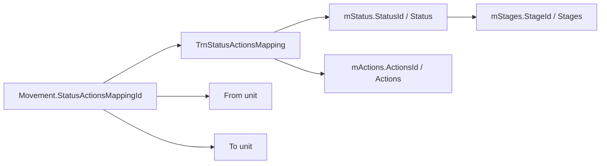

# Status and Action Mapping

## Data model

| Object | Key/columns | Verified meaning |
|---|---|---|
| `mStages` / `tbl_mStages` | `StagesId`, stage name | Stage/master grouping for statuses. |
| `mStatus` / `tbl_mStatus` | `StatusId`, `StageId`, `Status`, `InitiaalID`, `FininshID`, `Statseq`, `IsDashboard`, active/delete flags | Configured project status and lifecycle metadata. |
| `mActions` / `tbl_mActions` | `ActionsId`, `Actions`, `ActionDesc`, `OrderBy`, active/delete flags | Configured action labels/descriptions. |
| `TrnStatusActionsMapping` | `StatusActionsMappingId`, `StatusId`, `ActionsId`, `IsActive` | Maps an actionable transition choice to a status and action. |
| `TrnUnitStatusMapping` | `StatusActionsMappingId` and unit/status mapping fields | Unit-specific mapping configuration; exact columns/rows are runtime data. |
| `ProjStakeHolderMov` | `PsmId`, `ProjId`, `StatusActionsMappingId`, source/target units, flags | Historical/current movement carrying the selected mapping. |

## Resolution path

The repository uses this join to render movement history and current work lists. `CheckFwdCondition` also queries the mapping table and movement history to determine whether a forwarding prerequisite is present.

## Actual IDs visible in code

| ID | Where observed | Verified interpretation |
|---:|---|---|
| 1 | `enum1.Verify`; initial movement update branch; `CheckFwdCondition` action branch | Code uses it, but the database description is not available. Do not label it “Verify” universally. |
| 2 | `enum1.Pending`; `CheckFwdCondition` looks for `ActionsId == 2` | Code uses it, but action description is not available. Do not label it “Pending” universally. |
| 21 | `ProcessMail` movement sequence | Mapping ID used in configured comment sequence; description unavailable. |
| 26 | `ProcessMail` sequence | Mapping ID; description unavailable. |
| 31 | `ProcessMail` sequence | Mapping ID; description unavailable. |
| 37 | `ProcessMail` sequence | Mapping ID; description unavailable. |
| 78 | `FwdToProject` | Updates matching whitelist clearance timestamp. Mapping description unavailable. |
| 88 | `FwdToProject` | Marks matching whitelist row whitelisted and assigns certificate/validity timestamps. Mapping description unavailable. |
| 144, 149, 154 | `ProcessMail` sequence | Mapping IDs; descriptions unavailable. |
| 159 | `UpdateProjectAsync` when `Is_AI_ML == true` | Initial/update movement mapping for AI/ML branch; description unavailable. |

The integer `Verify=1` and `Pending=2` constants are not sufficient evidence that mapping ID 1 or action ID 2 has that description; they are declared in a generic helper and used in different contexts.

## Status/action transition table

The complete requested table cannot be safely populated from the repository because status/action seed rows and the full mapping matrix are not checked in. The following table records only code-backed transitions:

| Status/action identifier | Trigger | Next persisted operation | Responsible actor |
|---|---|---|---|
| Mapping `1` or `159` | Project update initial movement branch | Update current movement mapping and target unit 1/2 | Project creator/session unit; exact business role not established |
| Mapping `21`, `26`, `31`, `37`, `144`, `149`, `154` | `ProcessMail` | Insert movement rows to hard-coded target units | Unit 1/2 session only |
| Mapping `78` | Forward | Update matching `trnWhiteListed.Clearence` | Current receiving unit authorized to forward |
| Mapping `88` | Forward | Update matching whitelist `IsWhiteListed`, `CertNo`, `ValidUpto` | Current receiving unit authorized to forward |
| Action ID `1` / `2` checks | `CheckFwdCondition` | Gate only; no write | Current workflow user |

## Required deployment evidence

Export `mStages`, `mStatus`, `mActions`, `TrnStatusActionsMapping`, `TrnUnitStatusMapping`, and relevant `ProjStakeHolderMov` rows from the deployed database to complete human-readable names, next-status rules, unit eligibility, and approval/rejection meanings.
