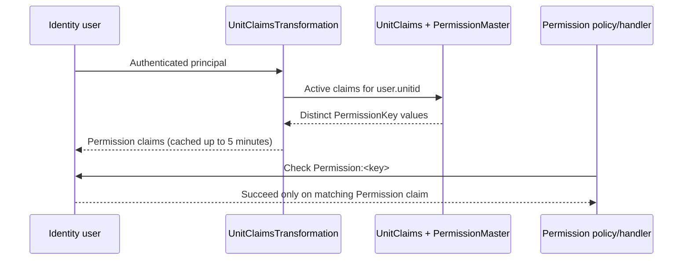

# User Roles and Responsibilities

## Identity and session

`Program.cs` configures ASP.NET Core Identity with `ApplicationUser` and SQL Server stores. Confirmed accounts are required for sign-in; failed access attempts lock the account after three failures for 60 minutes. `AccountController` and Identity Razor Pages provide application login/logout, registration, password and account management.

`ProjectsController` and related controllers also read a serialized `Login` object from session key `User`. That object carries the unit, application role, user ID, display identity, and crypto key used to protect workflow identifiers. A valid Identity cookie alone is not sufficient for many project operations when the session is missing.

## Roles and units

The code constant `RoleConstants` defines `Dte` and `unit` (the runtime login code also compares role text to `Unit` and `Dte`). `ApplicationUser` stores `RoleName`, `RoleName_IAM`, `unitid`, appointment and identity fields. Units are represented by `tbl_mUnitBranch`/`UnitDtl`; a movement routes using integer `FromUnitId` and `ToUnitId`.

The source does not establish a complete human-readable role catalogue. Unit names, hierarchy, and organizational meaning are database data (`tbl_mUnitBranch`, `tbl_Type`, `mCorps`, `mCommand`).

## Permission flow

`AuthorizePermissionAttribute("X")` creates policy `Permission:X`. The policy provider requires authentication and attaches a `PermissionRequirement`; the handler succeeds only when the principal contains a case-insensitive `Permission` claim equal to the required key. `UnitClaimsTransformation` loads active `UnitClaims` joined to active `PermissionMaster` records and caches by unit.

## Responsibilities evidenced by controllers

| Responsibility | Evidence |
|---|---|
| Project owner/stakeholder | `AddProject` assigns `StakeHolderId = Logins.unitid`; `GetMyProjects` filters by stakeholder ID through a procedure. |
| Receiving unit | `FwdToProject` requires current movement `ToUnitId == Logins.unitid`, incomplete, non-comment. |
| Central processing | `ProcessMail` rejects sessions except unit 1 or 2 and creates a configured movement sequence. |
| Workflow administrator | Actions, stages, statuses, stakeholders, units, status/action mappings, and permission controllers expose maintenance operations. |
| Auditor/analyst | Audit, history, dashboard, report, and search controllers expose read paths. |

## Authorization caveats

All project controllers are generally `[Authorize]`, but individual action permission attributes are selective. Some legacy CRUD endpoints check only session presence. Effective production responsibility therefore depends on both controller attributes and runtime permission/mapping data; a complete role-to-action matrix cannot be verified from source alone.
